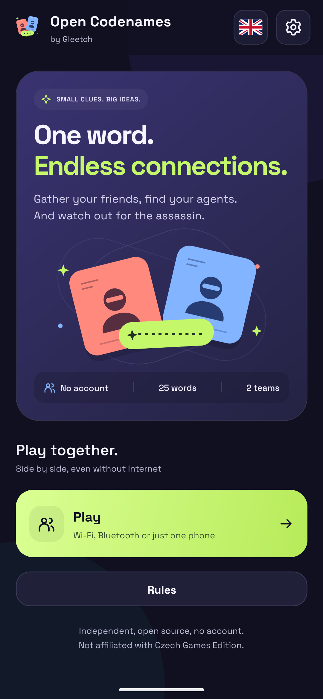
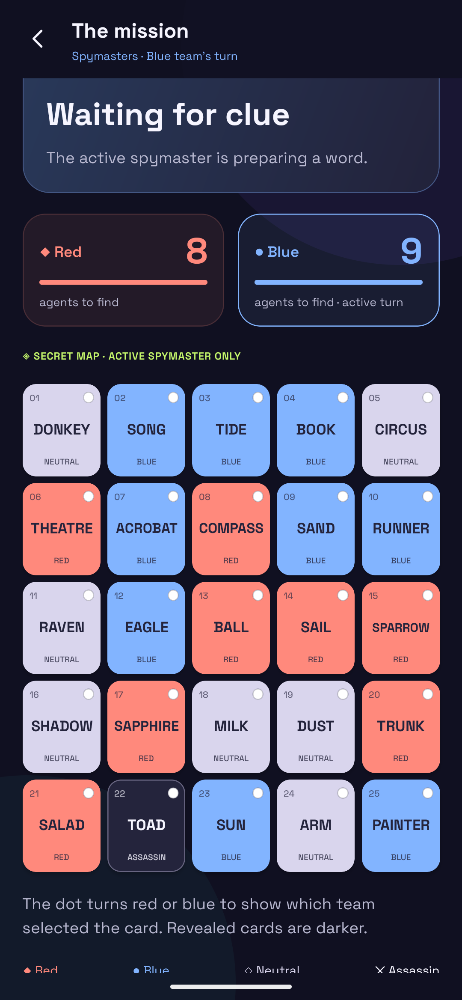

# Open Codenames

[English](README.md) | Italiano

Gioco Android indipendente di parole e spionaggio per persone vicine. Due squadre, 25 parole, un suggeritore e almeno un decifratore per squadra. Italiano, inglese, spagnolo, tedesco e francese, con contenuti inclusi; nessun account, pubblicità, telemetria, AI o servizio cloud durante l’utilizzo. Codice originale MIT. Non affiliato a Czech Games Edition.

**Versione 1.0.0:** [scarica l’APK Android dalla release GitHub](https://github.com/PaoloConteDev/OpenCodenames/releases/tag/v1.0.0). L’APK pubblico usa una firma privata diversa dalle precedenti anteprime: per sostituire un’anteprima firmata debug è necessario disinstallarla, perdendo i relativi dati locali. Tutti i dispositivi multiplayer devono usare la stessa versione esatta.

Il multiplayer Bluetooth e il ponte sperimentale dipendono dall’hardware; la verifica su quattro telefoni fisici è ancora da eseguire. I test automatici e l’emulatore non certificano la capacità radio. Consultare [verifiche e limiti](docs/VERIFICATION.md) e [collaudo reale](docs/DEVICE_TEST.md).

<p align="center">
  
  
</p>

## Avvio rapido Android

Requisiti di sviluppo: Node 22 LTS (almeno 22.13), npm, JDK 17 o 21, Android SDK Platform 36, Build Tools 36.0.0, NDK 27.1.12297006 e CMake richiesti da React Native. Gradle wrapper generato da Expo. La prima installazione/build scarica dipendenze: questo requisito riguarda lo sviluppo, **non il gioco nell’APK**.

```powershell
npm ci
npm run build:android
```

Lo script genera `android/` con Expo prebuild, controlla tipi, esegue test TypeScript e JVM e compila la variante **release con JavaScript e font incorporati**. Copia il risultato in `artifacts/open-codenames-preview.apk` se non è configurata una chiave privata. Questa variante è autonoma, firmata con la chiave di debug Android per il collaudo locale. Non richiede Metro, Expo Go, un account Expo, EAS o un PC durante il gioco.

Per compilare solo le architetture dei propri telefoni:

```powershell
powershell -ExecutionPolicy Bypass -File scripts/build-android.ps1 -Architectures arm64-v8a
```

La configurazione predefinita include ARM64, ARMv7 e x86_64; il primo APK verificato, se presente in `artifacts/`, può includere un sottoinsieme esplicitato in `docs/VERIFICATION.md`. Android minimo: **7.0 / API 24**. Target API 36. iOS, Expo Go e browser non sono supportati dall’MVP.

Per una distribuzione propria generare e conservare una chiave Android privata, poi impostare `OC_KEYSTORE` (percorso assoluto), `OC_STORE_PASSWORD`, `OC_KEY_ALIAS`, `OC_KEY_PASSWORD` prima della build. L’output diventa `open-codenames-release.apk`. Non salvare chiavi o password nel repository. Per aggiornare un’installazione serve la stessa chiave.

Per sviluppo con telefono USB:

```powershell
npm run android
npm start
```

Questa modalità usa il PC solo per lo sviluppo. Per il collaudo offline installare l’APK release con bundle incorporato, scollegare il PC e chiudere Metro.

## Lingue

Nella Home il pulsante quadrato con la bandiera selezionata, a sinistra dell’ingranaggio, apre **Scegli la lingua**. Sono disponibili Italiano, English, Español, Deutsch e Français, ciascuno con la propria bandiera accanto al nome (Italia, Regno Unito, Spagna, Germania, Francia). La bandiera nella Home segue subito la scelta salvata. Al primo avvio viene letta la lingua principale di Android: italiano, inglese, spagnolo, tedesco o francese vengono riconosciuti anche nelle varianti regionali (es. en-US, es-MX, fr-CA); le altre lingue usano inglese. La scelta iniziale viene salvata. Una preferenza valida già presente, anche impostata manualmente, prevale e non cambia ai successivi cambi della lingua del telefono. Le preferenze precedenti senza lingua seguono lo stesso rilevamento conservando suono e vibrazione. Interfaccia, ruoli, carte, regole, messaggi di partita e registro seguono questa scelta; i dialoghi di sistema Android seguono la lingua del telefono.

La lingua di chi ospita alla creazione determina il mazzo: 1022 parole italiane, 588 inglesi, 574 spagnole, 580 tedesche e 576 francesi, selezioni originali incluse nell’APK. Tutti ricevono le stesse parole dell’host; ciascun partecipante può usare un’interfaccia diversa. La lobby indica la lingua delle parole. Cambiare preferenza o riprendere una partita conserva il mazzo salvato, anche nelle missioni successive della stessa stanza. Per un mazzo diverso creare una nuova partita. Nomi, indizi e parole sul tabellone non vengono tradotti automaticamente. Tutto funziona senza Internet.

## Gestione partita

Dalla Home scegliere **Gioca**, poi il canale: **Wi-Fi / hotspot** (Dispositivi 2–10), **Bluetooth** (Dispositivi 2–8, collegamento diretto) o **Unico dispositivo** (1 dispositivo). Le tre scelte hanno lo stesso stile viola. Per Bluetooth e Wi-Fi/hotspot si sceglie quindi **Ospita partita** o **Entra in partita**; Unico dispositivo apre direttamente la preparazione. Chi ospita una stanza multiplayer sceglie fra Classica e Condivisa; la modalità resta fissa per la stanza:

- **Classica**, predefinita: da 4 a 10 dispositivi, squadra e ruolo personali, un suggeritore per squadra.
- **Condivisa**: da 2 a 10 dispositivi, esattamente uno per entrambi i suggeritori e uno o più per i **decifratori** (nome del ruolo precedentemente indicato come Indovinatore). L’host parte come dispositivo suggeritori; i nuovi ingressi sono decifratori. I ruoli possono essere riassegnati in lobby, mantenendo un solo dispositivo suggeritori. Non ci sono squadre fisse dei telefoni né shuffle in questa modalità.
- **Unico dispositivo**: un solo telefono passato fra suggeritori e decifratori di entrambe le squadre. Non servono Bluetooth, Wi-Fi, dati o altri dispositivi. Il ruolo cambia automaticamente secondo la fase: suggeritore per l’indizio, decifratori per le carte. La mappa è visibile solo nella fase suggeritore dopo conferma; viene nascosta subito all’invio dell’indizio, prima di passare il telefono ai decifratori. Anche questi ultimi devono confermare il passaggio. Al cambio turno si ricomincia con il suggeritore della squadra avversaria. Non consegnare il telefono con la mappa ancora visibile.

Per Unico dispositivo: **Gioca → Unico dispositivo → Prepara la partita → Avvia missione**. Non viene richiesto alcun nome; si può impostare soltanto il timer facoltativo prima di preparare la partita. Non ci sono inviti, ruoli personali o shuffle. **Salva ed esci** conserva la partita, recuperabile con **Riprendi la tua partita** nella Home. Blocco schermo/cambio app mette in pausa e conserva il tempo residuo; al ritorno o dopo riavvio serve una nuova conferma prima di mostrare la mappa. Il timer facoltativo include i passaggi del telefono.

In Condivisa, all’avvio e a ogni cambio turno ciascun telefono mostra **Passa il telefono alla squadra rossa/blu**. Confermare solo dopo averlo passato al relativo ruolo della squadra di turno. Il dispositivo dei suggeritori riceve i colori coperti solo dopo la propria conferma; i decifratori non li ricevono mai. Conferme riferite al vecchio turno vengono rifiutate, anche se arrivate dopo la scadenza del timer. Più telefoni possono confermare lo stesso turno contemporaneamente. Ruoli, conferme e turno sono salvati dall’host; dopo rientro serve la conferma del turno attuale se non era già stata data. Durante la sincronizzazione la UI condivisa nasconde il tabellone precedente.

Il timer facoltativo continua anche durante il passaggio. Le regole delle carte restano le stesse. Per le modalità multiplayer valgono approvazioni, stessa versione su tutti i telefoni e requisiti Bluetooth/hotspot. Tutti i dispositivi dei decifratori in Condivisa agiscono per la squadra di turno: il gruppo deve passarli a quella squadra; il software non può verificare chi tiene fisicamente il telefono.

## Giocare via Bluetooth

**Compatibilità dalla versione 0.3.2:** host, partecipanti e telefoni ponte devono usare la stessa versione esatta dell’app, comprese le patch (per esempio 0.3.1 e 0.3.2 non possono giocare insieme). Il controllo vale anche su hotspot/LAN e al rientro in una sessione salvata. Una versione diversa o precedente senza identificazione viene rifiutata con un messaggio che invita a installare la stessa versione. Il client interrompe i tentativi automatici finché non si richiede un nuovo ingresso. La versione è visibile nelle impostazioni e in diagnostica; proviene dallo stesso `package.json` usato per la versione Android. Aggiornare tutti i telefoni prima di riprendere una stanza.

1. Installare lo stesso APK sui telefoni, avviarlo almeno una volta e spegnere **Wi-Fi e dati mobili**. Lasciare acceso Bluetooth.
2. Host: **Gioca → Bluetooth → Ospita partita**, nickname e modalità Classica/Condivisa, “Apri la stanza”. Consentire Dispositivi vicini e la visibilità Android. Comunicare agli altri il nome del dispositivo mostrato nella lobby.
3. Altri telefoni: **Gioca → Bluetooth → Entra in partita**, nickname, “Cerca la stanza”. Scegliere il dispositivo host e richiedere ingresso. Eventuali dialoghi/notifiche di associazione sono quelli standard Android: controllare il codice e accettare su entrambi i telefoni.
4. L’host approva ogni richiesta. In Classica tutti scelgono squadra e ruolo; in Condivisa si sceglie il ruolo del dispositivo. Tutti confermano “Sono pronto”. Servono almeno quattro dispositivi in Classica o due in Condivisa, secondo la composizione descritta sopra.
5. L’host avvia. Entrambi i suggeritori vedono la mappa; solo il suggeritore attivo invia l’indizio. I decifratori attivi confermano una carta per volta. La prima scelta valida accettata prevale.

La visibilità termina dopo cinque minuti; l’host può rinnovarla dalla lobby. Le connessioni già aperte non dipendono dalla visibilità. Dalla versione 0.3.1 la ricerca mostra subito i dispositivi Classic rilevati e quelli già associati, anche quando Android non restituisce gli UUID del gioco. La verifica dei servizi avviene dopo la scansione: un dispositivo senza servizio riconosciuto resta selezionabile con **Prova collegamento all’host**, oppure **Collega come ponte sperimentale**. Riconoscere il nome del telefono prima di tentare; un dispositivo associato potrebbe essere spento o lontano. Il riconoscimento del servizio può provenire dalla cache Android e non garantisce che una stanza sia ancora aperta. Rimangono necessari associazione Android e approvazione dell’host.

Se l’host non compare, ripetere dopo averlo reso visibile oppure associare i telefoni dalle impostazioni Bluetooth e ripetere. È disponibile anche l’inserimento dell’indirizzo Bluetooth. Su Android 7–11 la scansione richiede il permesso Posizione e, secondo la configurazione del dispositivo, il relativo interruttore di sistema. L’app non raccoglie coordinate.

**Limite della stanza: dieci persone complessive, host incluso.** Bluetooth diretto conserva sette servizi SDP/RFCOMM distinti: host + sette client, massimo otto dispositivi nella rete Bluetooth diretta. Per arrivare a dieci è disponibile il **ponte Bluetooth sperimentale** descritto sotto. La capacità radio effettiva dipende da Android, chipset e dispositivi: nessun numero di client fisici è ancora stato verificato. Nessuna migrazione dell’host.

### Ponte Bluetooth sperimentale: fino a 10 dispositivi

1. Un partecipante approvato, collegato direttamente all’host, preme **Attiva ponte sperimentale** nella lobby. Il telefono mantiene il collegamento all’host e apre due servizi RFCOMM aggiuntivi. Accettare la visibilità Android.
2. Gli ultimi due partecipanti scelgono il dispositivo marcato **Ponte Bluetooth · sperimentale** nella ricerca. Per l’indirizzo manuale selezionare **Ponte sperimentale** e inserire il MAC del ponte.
3. Ogni nuovo partecipante confronta tutti i gruppi dell’impronta con **Impronta host** sul vero telefono host, poi preme **Conferma impronta**. Non confermare se differiscono. L’impronta è disponibile anche nella diagnostica durante la partita. Le credenziali vengono inviate solo dopo questa verifica; nei rientri la chiave salvata deve coincidere.
4. L’host approva anche questi ingressi. Esempio massimo: **1 host + 7 diretti (uno fa da ponte) + 2 attraverso il ponte = 10**. L’host rimane l’unica autorità; i suggeritori attraverso il ponte ricevono la propria mappa cifrata end-to-end. Il ponte può interrompere o ritardare il traffico, ma non ne riceve il contenuto in chiaro.
5. Host e ponte devono restare in primo piano per mantenere i collegamenti. Se manca il ponte, i suoi partecipanti risultano scollegati; gli altri possono continuare. Al rientro si sincronizzano. Dopo un riavvio del telefono ponte, rientrare nella propria sessione e riattivare il ponte dalla lobby o dalla diagnostica. Non sono supportati ponti su ponti o il cambio automatico di ponte.

Questa modalità richiede che il controller Android gestisca contemporaneamente il collegamento verso l’host e quelli verso i figli, attraverso più reti Bluetooth. **È sperimentale, non collaudata su hardware fisico e non garantita su ogni modello.** Se l’apertura dei servizi o il collegamento simultaneo fallisce, la UI segnala l’errore; per dieci persone è disponibile la modalità Wi-Fi/hotspot offline. La configurazione condivisa dei limiti è `config/session-limits.json`.

## Giocare su Wi-Fi / hotspot senza Internet

1. Collegare tutti alla stessa rete Wi-Fi o all’hotspot di un telefono. Il telefono hotspot può essere l’host. Disabilitare i dati mobili per dimostrare che Internet non serve.
2. Host: **Gioca → Wi-Fi / hotspot → Ospita partita**, nickname e modalità Classica/Condivisa, “Apri la stanza”. Nella lobby compaiono indirizzi IPv4 privati, porta `42831`, codice stanza e QR. Se compaiono più indirizzi, scegliere quello della rete condivisa.
3. Client: **Gioca → Wi-Fi / hotspot → Entra in partita**, nickname, “Cerca la stanza”. Scansionare il QR (permesso fotocamera richiesto solo qui) oppure inserire IPv4 e codice. L’host approva.
4. Se Android chiede di abbandonare una rete senza Internet, scegliere di rimanere. Disattivare eventuale isolamento client/AP sul router. L’app non modifica Wi-Fi, hotspot o dati mobili automaticamente.

Il QR contiene solo versione, IPv4, porta e codice stanza: nessuna mappa o credenziale personale. Il client accetta solo IPv4 privati, nessun DNS pubblico. I socket rifiutano peer non locali. Il permesso Android `INTERNET` è necessario per i socket TCP locali e non implica un backend. Il gioco non usa 4G/5G individuale.

Il listener LAN ammette **nove client oltre all’host**, fino a dieci dispositivi totali. Verificare anche il limite di client impostato dall’hotspot del telefono.

## Recupero e ciclo di vita

L’host deve tenere l’app in primo piano: il suo schermo rimane acceso. I partecipanti non host possono bloccare il telefono o cambiare app; il loro collegamento viene chiuso e la partita continua per chi è presente. Al rientro si ricollegano automaticamente con le proprie credenziali e ricevono lo snapshot attuale prima di poter agire. Nessun vecchio comando viene ripetuto. Il telefono ponte mantiene lo schermo acceso per servire i figli; se viene sospeso, anche i figli si ricollegano al suo ritorno.

Se è l’host ad andare in background, l’hosting viene sospeso, la partita salvata e il tempo residuo conservato. Al ritorno si riapre il trasporto e si riprende il timer. L’arresto improvviso dell’app non permette di conoscere l’istante esatto della sospensione: al recupero si usa il residuo della scadenza salvata; se è già trascorsa viene eseguito un solo cambio turno.

Dopo la chiusura/riapertura dell’app: host → **Riprendi la tua partita**. I client approvati dalla versione 0.3.0 rientrano automaticamente se non hanno scelto **Lascia stanza**; per le sessioni precedenti o lasciate esplicitamente rimane **Rientra nella tua sessione**. Iniziare a ospitare disattiva il rientro automatico nella vecchia sessione client. La stanza mantiene identità, ruoli, carte, versione e cronologia. Se cambia l’indirizzo LAN, l’host deve tornare raggiungibile allo stesso indirizzo per il recupero automatico; in alternativa tornare alla Home del client, richiedere un nuovo ingresso in lobby con i nuovi dati e rimuovere la vecchia presenza. Durante una partita con indirizzo modificato ripristinare l’indirizzo precedente o annullare e ricreare la stanza. Nessuna migrazione automatica.

Un comando senza conferma può essere ritrasmesso una volta con lo stesso ID finché la connessione rimane attiva. Al distacco viene abbandonato: **nessun comando pendente è rigiocato automaticamente dopo il rientro**. Controllare lo stato aggiornato prima di ripetere una scelta.

L’host conserva una sola stanza recuperabile; ospitarne una nuova sostituisce quella salvata. Il client conserva l’ultima sessione approvata. La disinstallazione elimina i dati. Backup Android disabilitato.

## Lobby e timer facoltativo

Gli ingressi approvati alternano rosso e blu, cominciando dal blu dopo l’host rosso. Ogni squadra ha un solo posto suggeritore, mostrato per primo e disabilitato per gli altri quando occupato. L’host può premere **Mescola squadre**: squadre bilanciate, suggeritori distribuiti uno per squadra e disponibilità di tutti azzerata per una nuova conferma.

Alla creazione l’host può attivare **Tempo per turno** scegliendo 30, 60, 90, 120 o 180 secondi. Di default non c’è limite. Il tempo comprende indizio e scelte; alla scadenza l’host passa automaticamente all’altra squadra, anche senza un tentativo. La scadenza è autorevole sul telefono host e il conto alla rovescia dei client tiene conto della differenza fra gli orologi. Una scelta arrivata dopo la scadenza non viene applicata al nuovo turno. Le stanze salvate prima della versione 0.3.0 restano senza timer. Il registro conserva gli ultimi 100 eventi, per mantenere limitati gli snapshot anche se si lasciano scadere molti turni senza scegliere carte.

Durante la partita la propria squadra è indicata anche nell’intestazione fissa. Le carte scoperte sono più scure; il pallino indica la squadra che ha scelto la carta, indipendentemente dal colore della parola. Le vecchie carte salvate senza questa informazione restano scoperte senza attribuzioni inventate.

## Architettura

| Area           | Implementazione                                                                                                     |
| -------------- | ------------------------------------------------------------------------------------------------------------------- |
| Motore puro    | `src/core/engine.ts`: generazione, regole, ruoli, proiezione dei dati                                               |
| Sessioni       | `src/session/authority.ts`: credenziali, coda seriale, commit atomico prima degli ACK, deduplicazione               |
| Protocollo     | `src/protocol/messages.ts`: schema validato, versione, comando e partita; `framing.ts`: codec di riferimento        |
| Orchestrazione | `src/session/runtime.ts`: approvazione, legame socket-sessione, heartbeat, timeout, recupero, stato UI              |
| Bluetooth      | `modules/offline-link/android/…/OfflineLinkModule.kt`: Bluetooth Classic/RFCOMM, SDP, sette canali indipendenti     |
| LAN            | Stesso modulo: ServerSocket/Socket TCP locali; nessun processo esterno                                              |
| Persistenza    | AtomicFile nella directory privata Android; file host, client e preferenze separati                                 |
| UI             | `App.tsx`: React Native, safe area, QR, accessibilità, conferme, diagnostica, regole e licenze                      |
| Contenuti      | `src/content/`: cinque mazzi originali e regole; `src/i18n/`: catalogo UI, interpolazione e traduzione dei messaggi |

L’host esegue il motore JavaScript dentro Hermes nell’APK. Kotlin gestisce I/O e archiviazione. Non esiste server Node da avviare durante la partita. Bluetooth non chiama API Wi-Fi, Nearby Connections, BLE o Google Play Services.

La schermata diagnostica permette subito la prova tecnica: approvare tre client, inviare ECO da ciascuno e verificarne la risposta, scollegare e rientrare. Gli eventi derivano dai socket effettivi. Vedere [protocollo e modello di fiducia](docs/PROTOCOL.md).

## Regole, contenuti e licenze

La UI usa una palette indaco/lime con squadre corallo e blu, illustrazioni vettoriali originali, sfumature, avatar, contatori con barre e carte in cinque righe esplicite. Transizioni, feedback dei pulsanti e rivelazione delle carte usano Animated nativo. L’illustrazione della Home si anima solo con l’app in primo piano e tutte le animazioni rispettano “Riduci animazioni” di Android. La versione 0.2.0 include un nuovo logo originale con due agenti e fumetto: `src/ui/brand.ts` è il sorgente condiviso da header, icona launcher e icona adattiva. `npm run logo:generate` rigenera gli SVG/PNG locali con resvg (solo sviluppo). Nessun asset remoto. Dalla 0.3.3 la Home mostra **by Gleetch** sotto il titolo e un pulsante quadrato con ingranaggio per le impostazioni in alto a destra.

Implementati tabellone 5×5, 9/8/7/1, N+1, almeno un tentativo prima di passare, 0 e infinito con tentativi illimitati, vittoria anche sull’ultima carta scelta dall’avversario, assassino e ruoli bloccati. Nessun timer obbligatorio. La schermata Regole descrive la politica sintattica degli indizi e i limiti del controllo automatico; non viene valutata la semantica.

Font, traduzioni e tutti e cinque i mazzi di parole sono incorporati. L’audio è sintetizzato localmente. [Provenienza dei contenuti](docs/CONTENTS.md), [MIT](LICENSE), [avvisi delle dipendenze](THIRD_PARTY_NOTICES.txt). Gli avvisi sono consultabili offline nelle impostazioni. Nessuna risorsa estratta dal prodotto ufficiale.

## Verifica

```powershell
npm run typecheck
npm test
npm run licenses
npx expo export --platform android --output-dir dist
# dopo prebuild, con JAVA_HOME e ANDROID_HOME corretti:
.\android\gradlew.bat -p android :offline-link:testReleaseUnitTest --console=plain
```

I test di protocollo e runtime impiegano I/O controllato esclusivamente nelle suite di test. Non esiste un trasporto simulato nel percorso dell’app. I risultati effettivamente ottenuti e i controlli non eseguiti sono elencati in [VERIFICATION.md](docs/VERIFICATION.md). Il collaudo su almeno quattro telefoni è un requisito prima di promuovere il progetto a release verificata.

È incluso anche `scripts/lan-smoke.cjs`: **client di collaudo per sviluppatori**, escluso dall’app. Consente tre collegamenti TCP reali verso l’host Android, approvati dalla sua UI. Con l’emulatore si può usare `adb forward tcp:42833 tcp:42831` e poi `node scripts/lan-smoke.cjs 127.0.0.1 42833 CODICE`. Comandi interattivi: `echo`, `configure`, `clue`, `reconnect N`, `quit`. Non stampa credenziali o mappa. L’app di produzione non importa questo script e non ne ha bisogno. Tale prova non certifica Bluetooth o un hotspot fisico.
